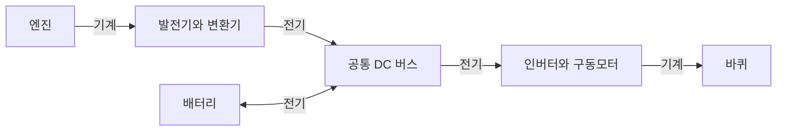

# EREV 발전과 구동 전력의 관계에 대한 정의 확인

작성일 2026-10-14 KST. 사용자 질문에 대한 공식 근거 확인이다. 새로운 발전계 선정, CRUISE M 프로젝트 변경 또는 실제 출력 검증을 수행한 기록이 아니다.

## 판단

순수 직렬형 EREV에서 엔진은 발전기를 구동하고 바퀴와 기계적으로 연결하지 않는다. 그러나 발전 전력이 주행 중 모터의 전기적 수요에 기여하는 것은 직렬형과 양립한다. '엔진이 바퀴를 직접 구동하지 않는다'와 '엔진 발전 전기가 모터에 공급되지 않는다'는 서로 다른 명제다.

'배터리만 충전'이라는 표현은 엔진의 발전 전용 역할을 설명하는 문구로 쓰이지만, 발전 전력을 모두 셀에 먼저 저장한 뒤 재방전한다는 전기회로 조건을 자동으로 뜻하지 않는다. 공통 DC 버스에서는 발전 공급과 모터 부하의 차이가 배터리 단자 순전력이다. 같은 셀·단자에서 충전과 방전을 별개의 에너지 흐름으로 중복 적산하지 않는다.

## 분류

PHEV는 외부 충전 가능한 하이브리드 범주이며 병렬형과 동의어가 아니다. 직렬 PHEV도 존재한다. Series HEV는 기계 연결의 구조를 말하고, EREV는 전기주행 중심에 발전계로 항속을 보완하는 차량 개념이다. 이번 연구는 외부 충전 가능한 배터리를 가진 순수 직렬형 가상 EREV로 정의한다. 시장의 모든 EREV 명칭이 하나의 기계 구조를 보장한다는 뜻은 아니다.

## 연구에서 사용하는 구조

엔진 또는 발전기에서 바퀴로 직접 연결하는 기계 경로는 없다. 발전기가 배터리와 같은 DC 공급 노드에 연결되는 개념이다. 실제 CRUISE M 포트 연결, 변환기와 보호제어는 해당 프로젝트에서 별도로 점검한다. 이 개념도만으로 실제 연결 검증을 완료하지 않는다.

## 전력수지 예

보조부하와 손실까지 동일 DC 경계로 반영한 수요를 Pdem, 버스 발전 순공급을 Pgen, 배터리 방전 양수 단자 전력을 Pbat로 두면 준정상 수지는 Pbat = Pdem - Pgen이다. 빠른 DC 링크 과도에서는 커패시터 저장에너지 변화도 포함한다.

예시 가정: 수요50kW와 발전26kW이면 배터리는24kW 방전한다. 수요10kW와 발전26kW이면 배터리가16kW를 받아 충전할 수 있다. 수요26kW와 발전26kW이면 배터리 순출력은0이다. 실제 충전수용·보호제어·변환 한계에 따라 지령을 억제할 수 있으므로 위 숫자는 이상적인 설명용 예다.

같은 버스 기준의 순간 공급 조건 Pdem <= Pbat_available + Pgen은 병렬형 기계 구동의 식이 아니라 전력수지 조건이다. 모터 토크/rpm, 인버터·변환기 한계와 버스전압 제약도 함께 충족해야 한다. 기동 중 공급되지 않는 발전26kW를 현재 가용전력에 더하지 않는다.

배터리가 공통 버스에 연결된다고 해서 모든 발전 전력이 배터리 전기화학적 저장/방전을 반드시 거치는 것은 아니다. 반대로 구체적으로 분리된 배터리 뱅크 등 특수 저장 경로를 연구한다면 그 별도 토폴로지와 상태방정식을 정의해야 하며, 이를 EREV 일반 정의로 간주하지 않는다.

## 공식 근거

1. Mazda UK 공식 보도자료, 2023-06-22, Mazda starts mass production of the MX-30 e-Skyactiv R-EV.
   https://uk.mazda-press.com/news/2023/mazda-starts-mass-production-of-the-mx-30-e-skyactiv-r-ev/
   발전기가 배터리를 충전하거나 필요 시 추가 전력을 공급하고, 엔진-바퀴 기계 연결 없이 모터로 항상 구동한다고 명시. 같은 차량을 series plug-in hybrid로 분류한다. 특정 차량의 상세 회로 수치 맵을 이 보도자료에서 확보한 것은 아니다.
2. US DOE AFDC Glossary, PHEV Configuration.
   https://afdc.energy.gov/glossary.html
   Parallel의 엔진/모터 기계 결합과 series plug-in hybrid의 모터 전용 휠 구동 및 엔진 발전 역할을 구분한다.
3. Argonne ANL/ESD/10-1, section2.4.2.2 Series Hybrid.
   https://www.energy.gov/sites/default/files/2014/03/f9/67242.pdf
   엔진 결합 발전기가 모터와 저장장치에 전기를 공급하는 직렬 구조를 설명한다. 해당 보고서의 SOC 운전 범위를 Bolt BMS 입력으로 전용하지 않는다.

## 연구에 미치는 영향과 다음 시작점

앞서 설명한 발전기 전력과 배터리 전력의 분담은 전기적 분담이다. 엔진 토크를 바퀴에 합산한다는 의미가 아니다. 기존 S0~S4 연구 방향과 순수 직렬 구조를 유지한다.

향후 발표에서는 '엔진은 발전 전용이고 바퀴는 모터만 구동한다. 발전 순공급은 배터리의 순방전 부담을 줄이고, 수요를 초과하면 배터리를 충전한다'라고 표현한다. SOC 회복 여부는 발전정격 자체가 아니라 발전 순공급과 현재 전기 부하의 차이로 판단한다.

현재 BEV검증 상태와066 미실행 상태는 이전 체크포인트를 계승한다. 이번 설명 확인을 실차EREV 또는 저SOC 성능 검증으로 기록하지 않는다. 지속 GitHub 게시 승인은 checkpoints/PROJECT_PUBLICATION_AUTHORIZATION.md를 계승한다.
